# Road Guard

> 딥러닝 기반 도로 위험 요소 인식 및 실시간 모니터링 시스템

Road Guard는 로봇 카메라 영상을 실시간으로 수집하고, 차선·보행자·차량·교통콘·포트홀을 분석하여 모니터링 화면과 데이터베이스에 전달하는 통합 인지 시스템입니다.

차선 세그멘테이션, 객체 검출·추적, 포트홀 위험도 산정 모델을 하나의 파이프라인으로 통합하며 웹 대시보드와 PyQt 모니터링 프로그램을 통해 결과를 확인할 수 있습니다.

[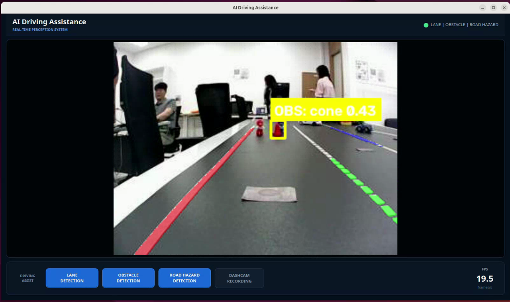](docs/road-guard-demo.webm)

> 위 이미지를 클릭하면 약 67초 길이의 전체 시스템 데모 영상을 볼 수 있습니다.

## 목차

- [주요 기능](#주요-기능)
- [시스템 구조](#시스템-구조)
- [AI 인지 모델](#ai-인지-모델)
- [포트홀 위험도 산정](#포트홀-위험도-산정)
- [실시간 처리 방식](#실시간-처리-방식)
- [모니터링](#모니터링)
- [데이터 구조와 API](#데이터-구조와-api)
- [프로젝트 구조](#프로젝트-구조)
- [설치 및 설정](#설치-및-설정)
- [실행 방법](#실행-방법)
- [알려진 제한 사항](#알려진-제한-사항)

## 주요 기능

- ROS 2 카메라 토픽 수신
- JPEG 영상의 UDP 분할 전송 및 재조립
- DeepLabV3+ 기반 차선 영역 분할과 차로 중심 추정
- YOLO 및 ByteTrack 기반 사람·차량·교통콘 검출과 추적
- 포트홀 검출·추적과 조감도 기반 위험도 분류
- 차선·객체·포트홀 모델의 병렬 추론
- PyQt 기반 실시간 오버레이 모니터링 및 MP4 녹화
- MySQL 기반 프레임별 검출 결과 저장
- 웹 대시보드 기반 누적 통계, 상세 데이터와 연결 상태 조회

> **현재 구현 범위**
> 이 저장소에는 영상 수집, AI 인지, 포트홀 위험도 분석, 시각화, 녹화 및 데이터 저장 기능이 구현되어 있습니다. 조향·속도 제어 명령을 로봇으로 전송하는 회피 주행 제어 모듈은 현재 포함되어 있지 않습니다.

## 시스템 구조

### 설계 아키텍처


설계상 시스템은 다음 영역으로 구분됩니다.

| 영역 | 구성 요소 | 역할 |
| --- | --- | --- |
| OOBoard / OOCarKit | Camera, Image Sender | 카메라 영상 취득 및 UDP 송신 |
| Service Manager | Web Server, DB | 프레임 중계, 상태 관리, 결과 저장과 Dashboard 제공 |
| AI Server | AI Service | 차선·객체·포트홀 추론 |
| 관리자 PC | Monitoring | 원본 영상과 AI 결과 실시간 표시 |
| Mobile | Controller | 제어 경로로 설계되었으나 현재 저장소에는 미포함 |

### 현재 저장소의 데이터 흐름

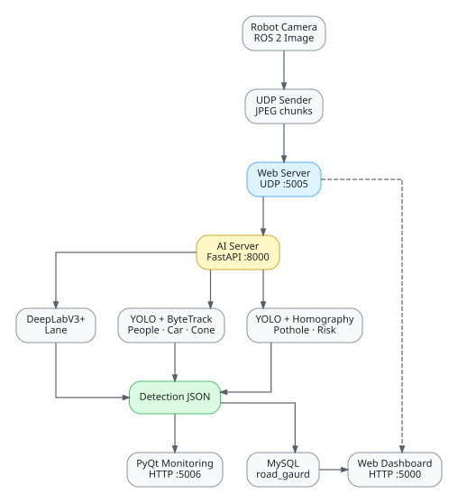

1. 로봇이 ROS 2 카메라 영상을 YUY2에서 BGR로 변환하고 JPEG로 압축합니다.
2. JPEG를 최대 60,000바이트 단위의 UDP 조각으로 나누어 웹 서버에 전송합니다.
3. 웹 서버가 `frame_id`를 기준으로 프레임을 재조립하고 AI 서버에 전달합니다.
4. AI 서버가 차선, 객체, 포트홀 추론을 병렬 수행합니다.
5. 웹 서버는 같은 프레임의 JPEG와 AI 분석 JSON을 PyQt 모니터링에 전달합니다.
6. 검출 결과는 MySQL에 저장되고 웹 대시보드에서 조회됩니다.

## AI 인지 모델

### 차선 인식

차선 인식에는 `segmentation_models_pytorch`의 DeepLabV3+가 사용됩니다.

| 항목 | 내용 |
| --- | --- |
| 모델 | DeepLabV3+ |
| Encoder | ResNet-34 |
| 입력 크기 | 512 × 512 |
| 출력 클래스 | 배경 포함 4개 클래스 |
| 출력 | 차선 Polygon과 `lane_center` |

| Class ID | 의미 | 후처리 결과 |
| ---: | --- | --- |
| 1 | 흰색 실선 계열 | Contour 기반 Polygon |
| 2 | 노란색 실선 계열 | Contour 기반 Polygon |
| 3 | 점선 차선 | Connected component 중심을 연결한 Polyline |

모델의 클래스별 Softmax confidence map을 계산하고 마스크를 원본 해상도로 복원합니다. 차선 마스크 하단의 여러 높이에서 좌우 경계를 찾은 뒤 화면 중심에 가장 가까운 경계 쌍의 중앙을 주행 차로 중심으로 반환합니다.

### 도로 객체 인식

사람, 차량, 교통콘은 Ultralytics YOLO와 ByteTrack을 이용해 검출하고 추적합니다.

| 모델 원본 클래스 | 시스템 출력 키 |
| --- | --- |
| `toy_person` | `people` |
| `toy_car` | `car` |
| `cone` | `trafficCone` |

ByteTrack이 추적 ID를 확정한 객체만 결과에 포함되며, 동일 객체는 연속 프레임에서 가능한 한 같은 `sequence_id`를 유지합니다.

### 포트홀 검출

포트홀 역시 YOLO와 ByteTrack으로 검출·추적합니다. 검출된 Bounding Box와 Confidence는 위험도 모듈로 전달됩니다.

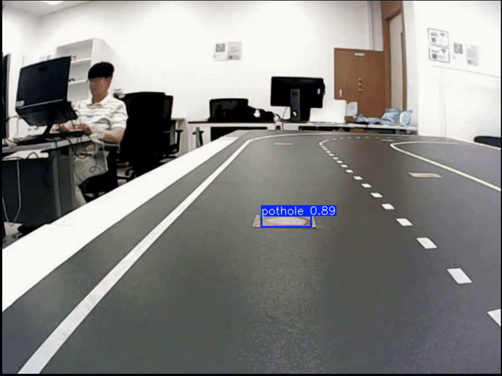

### 포트홀 모델 학습 결과

포트홀 검출 모델은 100 Epoch 동안 학습했습니다. 아래 그래프는 제공된 `model_results.png`에서 손실 함수와 평가 지표 영역을 원본 그대로 분리한 것입니다.

#### 학습·검증 손실

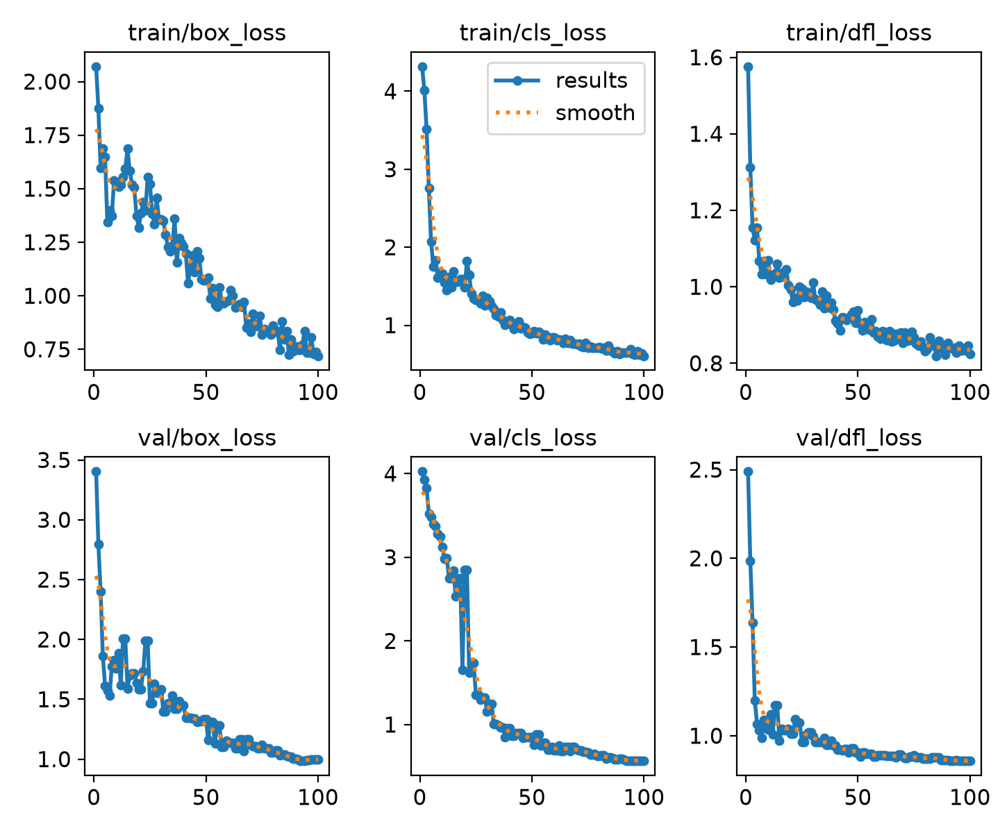

`box_loss`, `cls_loss`, `dfl_loss`가 학습과 검증 데이터 모두에서 전반적으로 감소하며 수렴하는 흐름을 보입니다.

#### 검출 지표

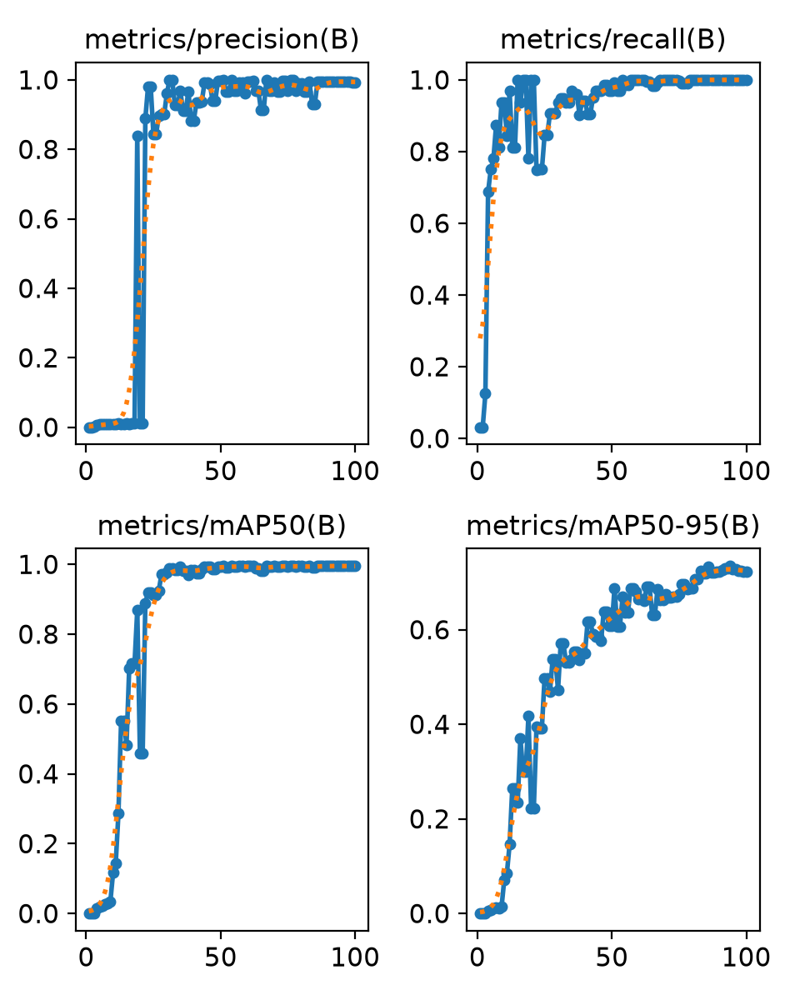

그래프상 후반 Epoch에서 Precision, Recall, mAP50이 높은 수준으로 수렴하고, mAP50-95도 지속적으로 개선됩니다. 이 그래프는 학습 과정의 추세를 보여주는 자료이며 별도의 고정 Test Dataset 평가 결과는 포함하지 않습니다.

## 포트홀 위험도 산정

포트홀 위험도는 카메라 영상의 Bounding Box 크기를 그대로 사용하지 않습니다. 원근에 따른 크기 왜곡을 줄이기 위해 포트홀 사각형을 상부 기준 좌표계로 투영한 후 면적을 계산합니다.

```text
Pothole Bounding Box
        ↓
입력 영상 해상도를 Calibration 해상도에 맞게 보정
        ↓
Homography Perspective Transform
        ↓
조감도 다각형 픽셀 면적 계산
        ↓
low / middle / high 분류
```

### 1. Perspective Calibration

로봇 카메라 시점과 상부 기준 시점에서 동일한 바닥 점을 지정하여 두 좌표계 사이의 Homography를 계산합니다.

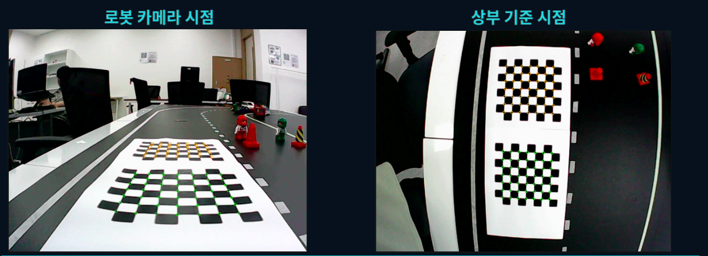

계산된 행렬을 적용하면 로봇 카메라의 원근 영상을 상부 기준 시점과 가까운 형태로 보정할 수 있습니다.

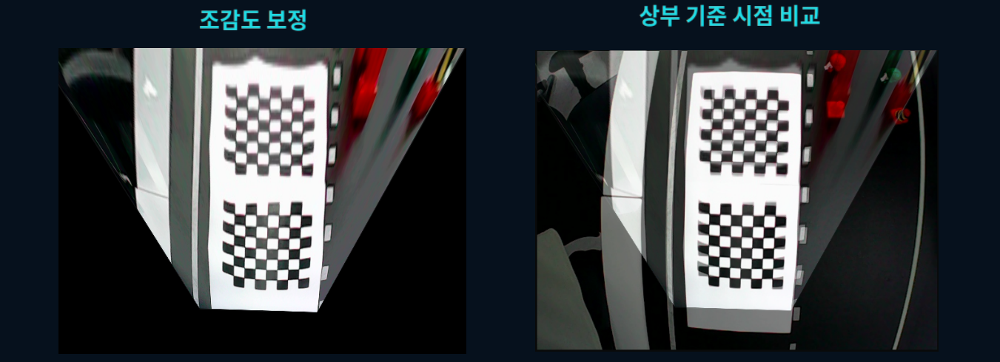

보정값은 `ai_server/perspective_calibration_robot_to_over.npz`에 저장되어 있습니다. 현재 입력 해상도가 보정 이미지와 다르면 먼저 좌표 크기를 보정한 뒤 Homography를 적용합니다.

### 2. 위험도 분류

변환된 Bounding Box Polygon의 면적을 `cv2.contourArea`로 구하고 다음 임계값으로 위험도를 분류합니다.

| 조감도 픽셀 면적 | 위험도 |
| ---: | --- |
| `< 551 px²` | `low` |
| `551–901 px²` | `middle` |
| `> 901 px²` | `high` |

| `low` | `middle` | `high` |
| :---: | :---: | :---: |
| 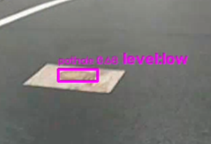 | 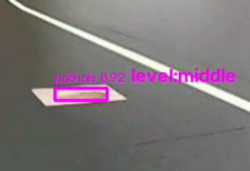 | 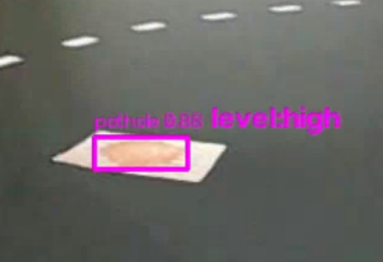 |

> 위험도 면적은 실제 면적 단위가 아닌 보정된 조감도상의 픽셀 면적입니다. 카메라 위치, 각도, 렌즈 또는 해상도가 변경되면 Homography와 임계값을 다시 검증해야 합니다.

## 실시간 처리 방식

### 모델별 병렬 추론

AI 서버는 모델마다 하나의 전용 `ThreadPoolExecutor`를 사용합니다.

- 차선, 객체, 포트홀 모델은 서로 병렬 실행됩니다.
- 같은 모델로 들어온 작업은 한 번에 하나씩 순서대로 처리됩니다.
- 모델은 FastAPI 서버 시작 시 한 번만 로드됩니다.
- 서버 종료 시 Executor와 모델 자원을 정리합니다.

### 최신 프레임 우선 큐

웹 서버는 처리 지연이 계속 누적되는 것을 방지하기 위해 제한된 크기의 큐를 사용합니다.

| 큐 | 최대 크기 | 가득 찼을 때 |
| --- | ---: | --- |
| AI 처리 대기 | 10 | 가장 오래된 프레임 제거 |
| PyQt 전송 대기 | 2 | 가장 오래된 결과 제거 |
| DB 저장 대기 | 100 | 가장 오래된 결과 제거 |

모든 프레임을 늦게 처리하기보다 현재 상황을 빠르게 표시하는 실시간 우선 방식입니다. PyQt 및 DB 전송에서 제거된 프레임 수는 런타임 상태에 누적됩니다.

### UDP 영상 프로토콜

| 필드 | 크기 | 설명 |
| --- | ---: | --- |
| `frame_id` | 2 bytes | 0–65535 순환 프레임 번호 |
| `chunk_idx` | 1 byte | 현재 조각 번호 |
| `total_chunks` | 1 byte | 전체 조각 수 |
| JPEG payload | 가변 | JPEG 데이터 일부 |

헤더는 Network Byte Order의 `!HBB` 형식입니다.

- 1초 이상 완성되지 않은 프레임 폐기
- Chunk 번호와 JPEG SOI Header 검증
- 3초 동안 패킷이 없으면 Robot 연결 끊김으로 판단
- UDP 재전송은 지원하지 않으며 손실된 프레임은 폐기

## 모니터링

### PyQt 실시간 모니터링

- **LANE** — 차선 Polygon, 점선 Polyline과 주행 차로 중심 표시
- **OBSTACLE** — 사람, 차량, 교통콘 Bounding Box 표시
- **ROAD HAZARD** — 포트홀 Bounding Box, Confidence와 위험도 표시
- **DASHCAM** — 현재 오버레이 화면을 MP4로 녹화
- 수신 FPS, 연결 상태와 활성 기능 표시

녹화 영상은 `gui/recordings/dashcam_YYYYMMDD_HHMMSS.mp4`에 생성됩니다.

전체 UI 동작은 [데모 영상](docs/road-guard-demo.webm)에서 확인할 수 있습니다.

### 웹 대시보드

Flask 기반 Dashboard는 MySQL에 저장된 분석 결과와 Web Server의 런타임 상태를 보여줍니다.

- Frames, Pothole, People, Traffic Cone, Car, Lane 누적 통계
- UDP, AI Server, Database, Monitoring 연결 상태
- 테이블별 상세 데이터와 Frame ID 검색
- 페이지 크기 10·20·50·100개 선택
- 5초 자동 갱신과 수동 새로고침
- 확인 절차를 포함한 전체 검출 데이터 초기화

#### Frame Summary

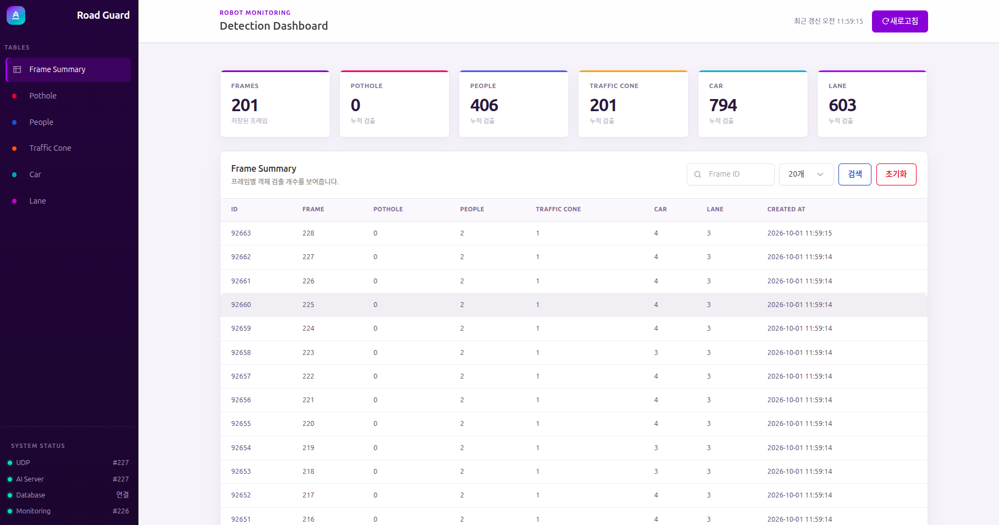

#### 객체 상세 조회

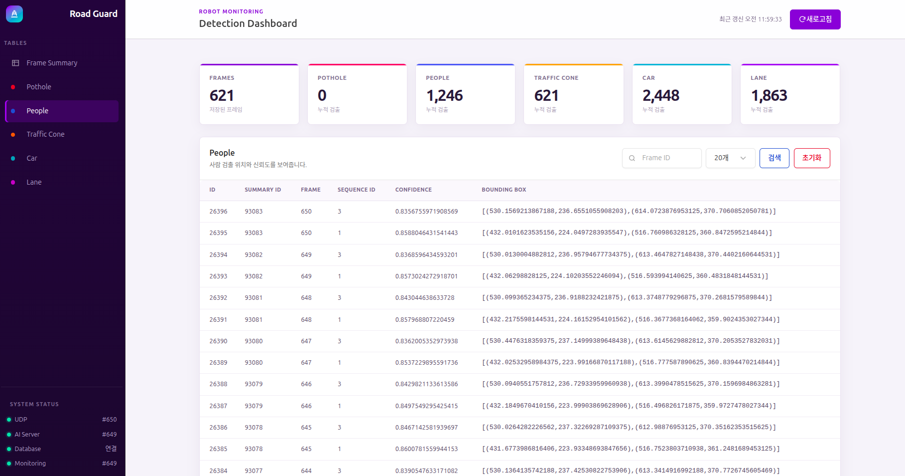

## 데이터 구조와 API

### AI 결과

```json
{
  "frame_id": 42,
  "detections": {
    "pothole": [
      {
        "sequence_id": 3,
        "confidence": 0.94,
        "b_box": {
          "x_min": 120.0,
          "y_min": 350.0,
          "x_max": 310.0,
          "y_max": 510.0
        },
        "risk_level": "high"
      }
    ],
    "people": [],
    "car": [],
    "trafficCone": [],
    "lane": [
      {
        "class_id": 1,
        "confidence": 0.91,
        "polygons": []
      }
    ],
    "lane_center": [
      {
        "x": 320,
        "y": 420,
        "left_x": 220,
        "right_x": 420
      }
    ]
  }
}
```

AI 서버는 포트홀 위험도를 `level`로 반환하며 웹 서버가 내부 공통 규격인 `risk_level`로 정규화합니다.

### 데이터베이스

```text
frame_summary
├── pothole       sequence_id, confidence, b_box, risk_level
├── people        sequence_id, confidence, b_box
├── trafficCone   sequence_id, confidence, b_box
├── car           sequence_id, confidence, b_box
└── lane          class_id, confidence
```

프레임 요약과 세부 검출 결과는 하나의 Transaction으로 저장됩니다. 오류가 발생하면 해당 프레임의 전체 저장 작업을 Rollback합니다.

### AI 추론 API

```http
POST /inference?frame_id={frame_id}
Content-Type: multipart/form-data
```

```bash
curl -X POST \
  "http://localhost:8000/inference?frame_id=1" \
  -F "file=@sample.jpg"
```

### 웹 서버 API

| Method | Endpoint | 설명 |
| --- | --- | --- |
| `GET` | `/` | 웹 대시보드 |
| `GET` | `/status` | 전체 시스템 런타임 상태 |
| `GET` | `/api/dashboard/summary` | 누적 검출 통계 |
| `GET` | `/api/tables/<table_name>` | 테이블 페이지 조회 |
| `POST` | `/api/database/reset` | 전체 검출 데이터 삭제 |

테이블 조회 파라미터 예시는 `?page=1&page_size=20&frame=42`입니다.

## 프로젝트 구조

```text
deeplearning-repo-2/
├── ai_server/
│   ├── main.py
│   ├── risk_level_module.py
│   ├── perspective_calibration_robot_to_over.npz
│   ├── inference/
│   │   ├── lane.py
│   │   ├── obstacle.py
│   │   ├── pothole.py
│   │   └── model_files.py
│   └── models/
│       └── model_drive_link.txt
├── robot/
│   └── udp_image_sender.py
├── web_server/
│   ├── web_server.py
│   ├── network_modules/
│   │   ├── ai_module.py
│   │   ├── db_module.py
│   │   ├── monitoring_module.py
│   │   └── udp_module.py
│   ├── templates/dashboard.html
│   └── static/
├── gui/
│   ├── monitoring.py
│   └── ui.ui
├── json_schema/
│   └── protocol.json
└── docs/
    └── README 이미지 및 데모 자료
```

## 설치 및 설정

### 주요 요구 사항

- Python 3
- CUDA 지원 NVIDIA GPU
- ROS 2
- MySQL
- PyTorch, OpenCV, NumPy
- FastAPI, Uvicorn, Flask, Requests
- Ultralytics, `segmentation-models-pytorch`
- PyQt6, `mysql-connector-python`, gdown

객체 및 포트홀 모델은 코드에서 명시적으로 CUDA 장치로 이동하므로 현재 구현 기준으로 NVIDIA GPU와 CUDA 환경이 필요합니다.

현재 저장소에는 고정된 의존성 파일이 없으므로 아래 명령은 개발 환경 구성을 위한 예시입니다. PyTorch는 사용하는 CUDA 버전에 맞는 공식 Wheel을 먼저 설치하는 것을 권장합니다.

```bash
python3 -m venv .venv
source .venv/bin/activate

pip install \
  fastapi "uvicorn[standard]" python-multipart \
  opencv-python numpy torch torchvision \
  segmentation-models-pytorch ultralytics gdown \
  flask requests mysql-connector-python PyQt6
```

`rclpy`와 `sensor_msgs`는 사용하는 ROS 2 배포판을 통해 설치해야 합니다.

### 네트워크와 서비스 설정

| 설정 | 기본값 | 위치 |
| --- | --- | --- |
| Robot 전송 대상 | `192.168.0.224:5005` | `robot/udp_image_sender.py` |
| Web UDP 수신 | `0.0.0.0:5005` | `web_server/web_server.py` |
| AI 서버 주소 | `http://192.168.0.4:8000/inference` | `AI_URL` 환경 변수 |
| PyQt 수신 주소 | `http://192.168.0.4:5006/frame` | `MONITORING_URL` 환경 변수 |
| Web Dashboard | `0.0.0.0:5000` | `web_server/web_server.py` |
| MySQL DB | `localhost:3306/road_gaurd` | `web_server/web_server.py` |
| ROS 2 Topic | `/ascamera/camera_publisher/rgb0/image` | `robot/udp_image_sender.py` |

```bash
export AI_URL="http://127.0.0.1:8000/inference"
export MONITORING_URL="http://127.0.0.1:5006/frame"
```

> `road_gaurd`는 현재 코드에 사용된 데이터베이스 이름입니다. `guard`가 아닌 `gaurd`인 점에 주의하세요.

### 모델 파일

```text
ai_server/models/
├── obstacle.pt
├── pothole.pt
└── <lane-model>.pth
```

모델 파일이 없으면 `model_drive_link.txt`에 지정된 Google Drive 폴더에서 자동으로 다운로드합니다. `.pt`와 `.pth` 파일은 Git 추적 대상에서 제외되어 있습니다.

## 실행 방법

### 1. MySQL 준비

`road_gaurd` 데이터베이스와 다음 테이블이 필요합니다.

```text
frame_summary, pothole, people, trafficCone, car, lane
```

현재 저장소에는 테이블 생성 SQL이 포함되어 있지 않으므로 별도의 Schema 생성이 필요합니다.

### 2. PyQt 모니터링 실행

```bash
python3 gui/monitoring.py
```

PyQt 프로그램은 `0.0.0.0:5006/frame`에서 웹 서버의 전송을 기다립니다.

### 3. AI 서버 실행

```bash
cd ai_server
uvicorn main:app --host 0.0.0.0 --port 8000
```

서버 시작 시 차선, 객체, 포트홀 모델을 메모리에 로드합니다.

### 4. 웹 서버 실행

저장소 루트에서 실행합니다.

```bash
python3 -m web_server.web_server
```

Dashboard 주소는 `http://localhost:5000`입니다.

### 5. 로봇 영상 송신 실행

`robot/udp_image_sender.py`의 `server_addr`를 웹 서버 주소에 맞게 설정한 후 실행합니다.

```bash
source /opt/ros/$ROS_DISTRO/setup.bash
python3 robot/udp_image_sender.py
```

### 시스템 상태 확인

```bash
curl http://localhost:5000/status
```

상태 API에서는 마지막 Robot 수신 프레임, AI 처리 프레임, PyQt 전송 프레임, DB 저장 프레임, 연결 오류, 큐 크기와 누적 Drop 수를 확인할 수 있습니다.
